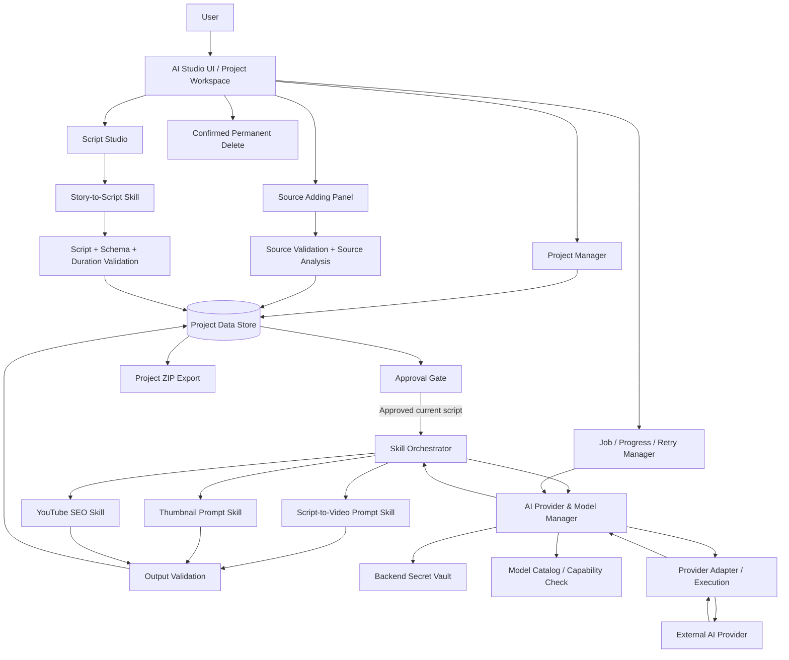
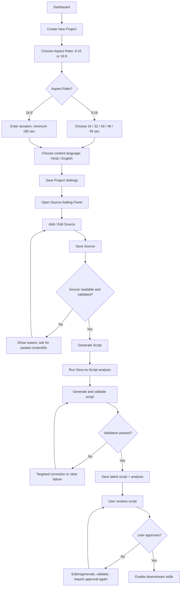
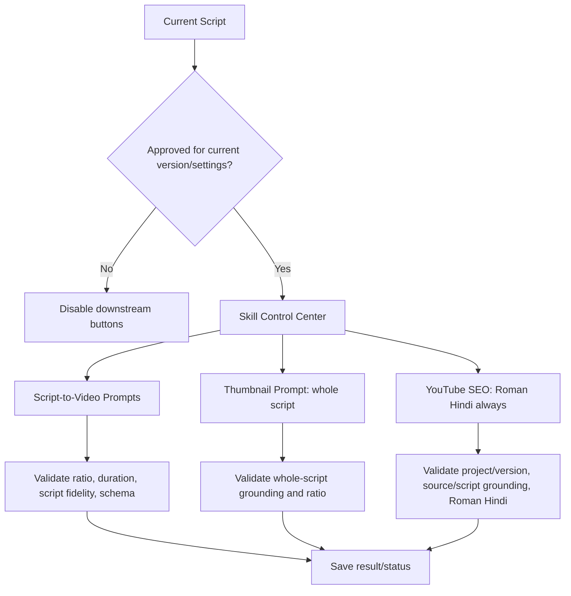
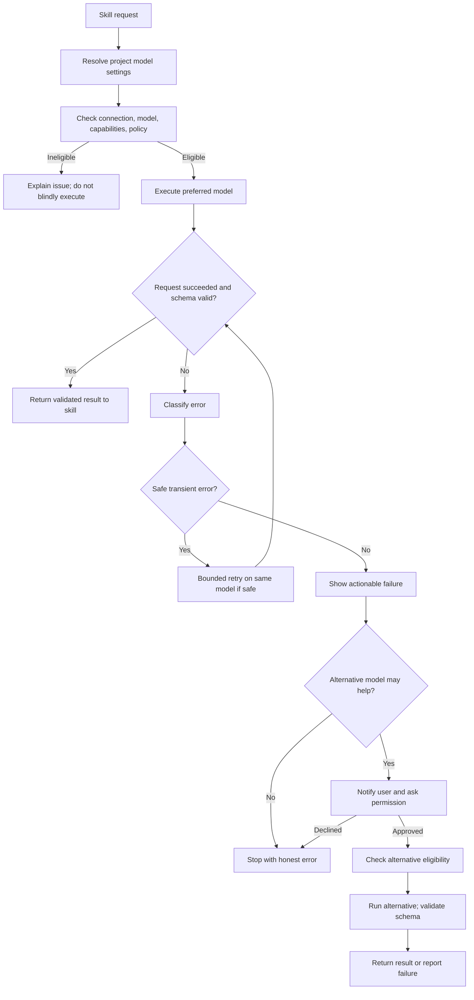
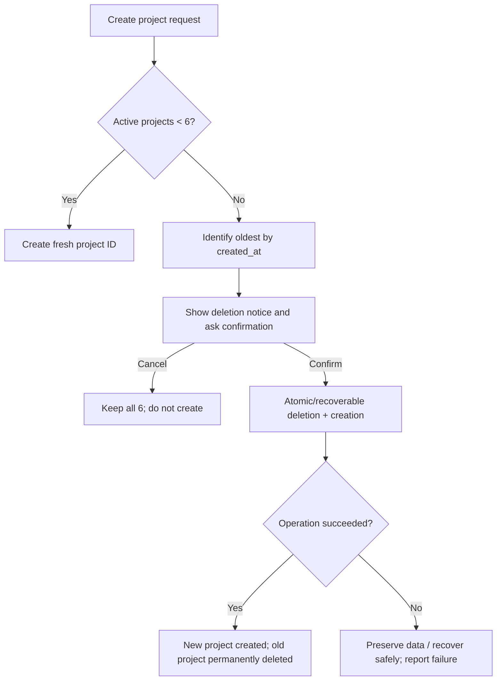
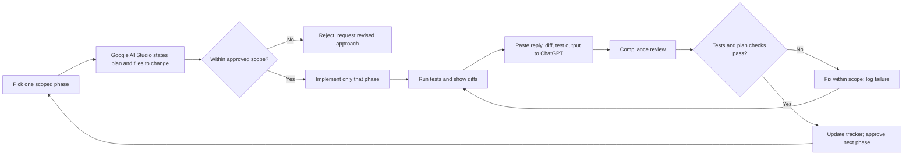
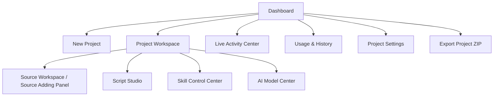

# 2. ARCHITECTURE AND VISUAL DIAGRAMS

## 2.1 High-level architecture

## 2.2 New project and source-to-script workflow

## 2.3 Approved script to three downstream skills

## 2.4 Provider request and permission-based fallback

## 2.5 Project lifecycle and deletion guard

## 2.6 Implementation and review loop

## 2.7 UI navigation map

## 2.8 Requirement traceability
Every implementation task should reference:
- requirement ID in `09_TEST_AND_ACCEPTANCE_MATRIX.md`;
- roadmap phase in `11_IMPLEMENTATION_ROADMAP.md`;
- files/components changed;
- test command and result;
- status/evidence in `03_BUILD_STATUS_AND_TRACKER.md` and `14_CHANGELOG_AND_PROGRESS_LOG.md`.
